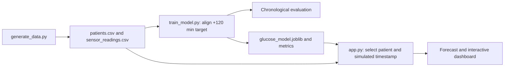

# GlucoTwin

**A synthetic digital twin prototype for exploring two-hour glucose forecasting.**

## Overview

GlucoTwin generates fictional patient profiles and simulated 15-minute sensor readings, trains a model to estimate glucose 120 minutes ahead, and presents the current simulated state and forecast in a Streamlit dashboard. It is an engineering and education project; it is not clinically validated and must not be used for medical decisions.

## Key features

- Seeded generation of synthetic EHR-style profiles and sensor streams.
- Two-hour prediction target aligned eight 15-minute samples ahead.
- Chronological holdout evaluation against a last-value baseline.
- Interactive patient selection, simulated stream advancement, and forecast chart.
- Scikit-learn gradient boosting with a NumPy ridge fallback.

## Tech stack

Python, Streamlit, pandas, NumPy, scikit-learn, Plotly, joblib, and pytest.

## Architecture and workflow



The model uses current simulated sensor values and the selected synthetic profile to estimate glucose at the current timestamp plus two hours.

## Project structure

```text
.
├── app.py
├── forecast.py
├── generate_data.py
├── train_model.py
├── model_utils.py
├── data/                 # Synthetic profiles, readings, and metrics
├── models/               # Trained model artifact and metrics
├── tests/                # Pipeline tests
└── docs/                 # Architecture and presentation materials
```

## Installation and execution

Requires Python 3.10–3.13. From the repository root:

```bash
python -m venv .venv
# Activate the environment for your shell, then:
python -m pip install -r requirements.txt
python generate_data.py
python train_model.py
streamlit run app.py
```

The repository includes generated CSV data and a trained model artifact. The generation and training commands reproduce them using the default seed.

## Screenshots and demo

No standalone application screenshot or deployed demo link is included. See the [project presentation](docs/presentation.pdf) and [architecture document](docs/architecture.pdf).

## Author

**Gireesh Sadanand Patgar** · [GitHub](https://github.com/gireeshpatgar17)
